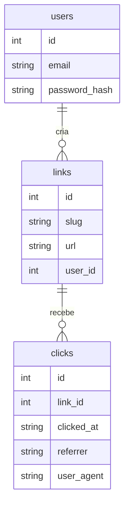

# Links API

[](https://github.com/FelipeYabiko/links-api/actions/workflows/ci.yml)


API REST de **encurtador de URLs** com contas de usuário, autenticação JWT e estatísticas de cliques por dia e por
origem. Feita com **TypeScript**, **Fastify** e **SQLite**, documentada com **OpenAPI** e empacotada com **Docker**.

## Funcionalidades

- Cadastro e login com senha protegida por `scrypt` e tokens **JWT** com validade de 1 hora
- Links com slug aleatório ou personalizado (`/meu-link`), com bloqueio de slugs reservados
- Redirecionamento `302` que registra data, origem (`Referer`) e navegador de cada clique
- Estatísticas por link: total, cliques por dia e as 5 principais origens
- Cada usuário só vê e apaga os próprios links
- Validação de entrada por JSON Schema (TypeBox), com os tipos do TypeScript gerados a partir do mesmo schema
- Rate limiting global e um limite mais rígido em login e cadastro
- Documentação interativa (Swagger UI) em `/docs`
- Migrações de banco versionadas, testes de integração e CI com build da imagem Docker

## Endpoints

| Método   | Rota                 | Auth | Descrição                             |
| -------- | -------------------- | ---- | ------------------------------------- |
| `POST`   | `/auth/register`     |      | Cria uma conta                        |
| `POST`   | `/auth/login`        |      | Devolve um token JWT                  |
| `POST`   | `/links`             | JWT  | Encurta uma URL (`slug` opcional)     |
| `GET`    | `/links`             | JWT  | Lista seus links com total de cliques |
| `GET`    | `/links/:slug/stats` | JWT  | Estatísticas de um link               |
| `DELETE` | `/links/:slug`       | JWT  | Apaga um link                         |
| `GET`    | `/:slug`             |      | Redireciona para a URL original       |
| `GET`    | `/docs`              |      | Swagger UI                            |
| `GET`    | `/health`            |      | Health check                          |

## Exemplo

```bash
B=http://localhost:3000

curl -X POST $B/auth/register -H 'content-type: application/json' \
  -d '{"email":"felipe@example.com","password":"senha-forte-123"}'

TOKEN=$(curl -s -X POST $B/auth/login -H 'content-type: application/json' \
  -d '{"email":"felipe@example.com","password":"senha-forte-123"}' | jq -r .token)

curl -X POST $B/links -H "authorization: Bearer $TOKEN" -H 'content-type: application/json' \
  -d '{"url":"https://github.com/FelipeYabiko","slug":"github"}'
# {"slug":"github","url":"https://github.com/FelipeYabiko","shortUrl":"http://localhost:3000/github","clicks":0,...}

curl -i $B/github            # HTTP/1.1 302 Found, Location: https://github.com/FelipeYabiko

curl $B/links/github/stats -H "authorization: Bearer $TOKEN"
# {"slug":"github","totalClicks":1,"clicksByDay":[{"day":"2026-10-21","clicks":1}],"topReferrers":[{"referrer":"direto","clicks":1}]}
```

## Como rodar

### Com Docker

```bash
cp .env.example .env          # preencha JWT_SECRET (openssl rand -hex 32)
docker compose up --build
```

### Localmente

Requer Node.js 22+.

```bash
npm install
JWT_SECRET=$(openssl rand -hex 32) npm run dev
```

| Variável        | Padrão                  | Descrição                                             |
| --------------- | ----------------------- | ----------------------------------------------------- |
| `JWT_SECRET`    | obrigatória             | Segredo para assinar os tokens (mínimo 32 caracteres) |
| `PORT`          | `3000`                  | Porta HTTP                                            |
| `DATABASE_PATH` | `links.db`              | Arquivo do SQLite                                     |
| `BASE_URL`      | `http://localhost:PORT` | Domínio usado no `shortUrl`                           |

## Scripts

```bash
npm test               # testes de integração (Vitest + app.inject)
npm run typecheck      # checagem de tipos
npm run lint           # ESLint
npm run format:check   # Prettier
npm run build          # compila para dist/
```

## Arquitetura

```text
src/
├── server.ts          # lê variáveis de ambiente, sobe o servidor e encerra com elegância
├── app.ts             # monta o Fastify: plugins, autenticação, OpenAPI e rotas
├── db.ts              # conexão SQLite e migrações versionadas
├── password.ts        # hash e verificação de senha com scrypt
├── slug.ts            # geração de slugs aleatórios
├── schemas.ts         # schemas TypeBox compartilhados
└── routes/
    ├── auth.ts        # cadastro e login
    ├── links.ts       # CRUD de links e estatísticas
    └── redirect.ts    # GET /:slug
test/app.test.ts       # testes de ponta a ponta com banco em memória
```



Quer entender cada conceito em detalhe? Veja o [guia de estudo](docs/GUIA-DE-ESTUDO.md).

## Licença

MIT
